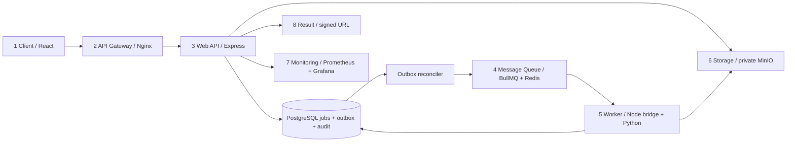

# Containerized Image Processing Service with Kubernetes Queue Workers

**CloudFrame** is a functioning asynchronous image processing application for Advanced Cloud Computing: React → Nginx → Express → PostgreSQL outbox → BullMQ / Redis → Node bridge + Python Pillow → private MinIO output. Kubernetes scales the combined processing pods using KEDA.

The application implements multiple uploads, real image transformations, persistent job history and audits, automatic and manual retries, iterative editing of completed results, result comparison, expiring downloads, API-derived dashboard statistics, service monitoring and an interactive eight-module architecture page. A generated demo image goes through the same real pipeline; no operational values are fabricated.

## Project explanation and presentation

- [Presentation summary — 10-slide PDF](docs/PROJECT_PRESENTATION.pdf), with architecture, technology roles, cloud concepts, recorded test results and demo steps. [Editable HTML source](docs/PROJECT_PRESENTATION.html).
- [Detailed project explanation — Word document](docs/PROJECT_EXPLANATION.docx) and [Markdown source](docs/PROJECT_EXPLANATION.md), covering the full workflow, technologies, upload limits, worker counts and monitoring.

Regenerate the PDF with `node scripts/export_project_presentation.mjs` after installing the project dependencies and Playwright Chromium. Regenerate the Word guide with `python scripts/export_project_guide.py` after installing `scripts/requirements-docs.txt`. The presentation summarizes recorded verification from 25 October 2026; generating documents does not rerun the application tests.

## Quick start with Docker Compose

Prerequisites: Docker Desktop running Linux containers with Compose v2+; allocate about 6 GB RAM / 4 CPUs for Compose, or 8 GB RAM when also running kind/monitoring. Allow about 30 GB free disk for first source builds, caches and local cluster images. Node 22.12+ and Python 3.12+ are needed only for host development/tests. Kubernetes requires kind or minikube, kubectl and Helm.

PowerShell, from the project directory:

```powershell
Copy-Item .env.example .env
docker compose --profile monitoring up --build -d
docker compose ps
curl.exe http://localhost:3000/api/v1/health/ready
```

On Linux/macOS use `cp .env.example .env` and `curl`. Keep an existing `.env` rather than overwriting it. The included passwords are local development samples. The first build compiles a pinned upstream MinIO release from source and can take several minutes.

| Service | Local URL |
| --- | --- |
| Dashboard | http://localhost:8080 |
| API / Swagger | http://localhost:3000/api/v1/docs |
| Readiness | http://localhost:3000/api/v1/health/ready |
| Prometheus metrics | http://localhost:3000/api/v1/metrics |
| MinIO S3 / console | http://localhost:9000 / http://localhost:9001 |
| Prometheus | http://localhost:9090 |
| Grafana | http://localhost:3002 (admin / `GRAFANA_ADMIN_PASSWORD`) |

Monitoring uses the `monitoring` profile to keep the default stack light. Without it: `docker compose up --build -d`. PostgreSQL, Redis and MinIO have persistent volumes. `docker compose down` stops services and preserves those volumes. Do not remove volumes if you need the stored images and history.

Visit **Process Images**, choose **Try a generated demo image**, set a width and output format, then submit. Follow queued → processing → completed, inspect both previews, and download the processed image. The API never runs Pillow inside the request handler.

Actual live-test captures: [dashboard](docs/screenshots/dashboard.png) and [before/after result](docs/screenshots/completed-job.png). The images and operational values shown come from real generated-fixture jobs.

## Host development

```powershell
Copy-Item .env.example .env
npm.cmd ci
python -m venv .venv
.\.venv\Scripts\python.exe -m pip install -r worker/requirements.txt
docker compose up --build -d postgres redis minio
npm.cmd run db:migrate
npm.cmd run db:generate
```

Set `PYTHON_BIN` in `.env` to the absolute `.venv/Scripts/python.exe` path on Windows (or `.venv/bin/python` on Unix). Host `.env` uses localhost for dependencies; Compose replaces those endpoints with container DNS names. Run these in separate terminals:

```powershell
npm.cmd run dev:api
npm.cmd run dev:bridge
npm.cmd run dev -w frontend
```

Frontend development URL: http://localhost:5173. Vite proxies `/api` to port 3000. `npm run build` compiles all TypeScript, generates Prisma and builds production frontend assets. `npm run start:api` / `npm run start:bridge` start compiled services after a build.

## Verification

```powershell
npm.cmd test
npm.cmd run validate:openapi
.\.venv\Scripts\python.exe -m pytest tests/test_processing.py -q
npm.cmd run build
npm.cmd run verify:infra
npm.cmd run test:browser:install
npm.cmd run test:e2e
# After the actual full Compose stack is healthy:
$env:BASE_URL='http://localhost:8080'
$env:LIVE_E2E='1'
npm.cmd run test:e2e
```

The seven-case browser suite includes two explicit offline UI cases and five gated live cases covering all six pages on desktop/mobile, real transformations, job progress, previews and signed downloads. API boundary tests mock external dependencies and exercise real Express and Sharp validation; parser tests validate the OpenAPI schema/references; live tests exercise deployed services. See [actual execution results](docs/PROGRESS.md).

## API example

```powershell
.\.venv\Scripts\python.exe scripts/fixtures.py
curl.exe -X POST http://localhost:3000/api/v1/images/upload -F "images=@tests/fixtures/demo-landscape.png"
# Insert the returned upload UUID:
$body = @{ uploadIds=@('UPLOAD_UUID'); transformations=@{width=640;format='webp';quality=80;grayscale=$true} } | ConvertTo-Json
Invoke-RestMethod http://localhost:3000/api/v1/jobs -Method Post -ContentType application/json -Body $body
```

Creation returns **202 Accepted**, with persisted queued jobs. Poll `/api/v1/jobs/JOB_UUID` every two seconds; obtain `/api/v1/jobs/JOB_UUID/download` after completion for a five-minute S3 URL. [API contracts](docs/API.md) cover all endpoints and SSE.

## Architecture



The bridge uses BullMQ's supported Node Worker API and dispatches to a Python child process through JSON stdin/stdout. Python never reads or mutates BullMQ's Redis keys. The processing container includes both runtimes, so KEDA adds actual Python processing capacity. One minimum worker handles delayed retries and stalled jobs that are outside the wait list. [Architecture and viva notes](docs/ARCHITECTURE.md).

## Project layout

```text
frontend/                   React, Vite, Tailwind, TanStack Query, Recharts
backend/src/                Express API, services, contracts, storage, outbox
backend/prisma/             PostgreSQL schema and initial SQL migration
queue-bridge/               BullMQ consumer, bounded Python dispatcher, Dockerfile
worker/                     Pure image transforms, S3 runner, Python Dockerfile
infrastructure/docker/      Nginx and pinned MinIO source build
infrastructure/kubernetes/  Kustomize base, Secrets example, KEDA, ingress, kind
infrastructure/monitoring/  Prometheus and Grafana Compose/Kubernetes provisioning
tests/                      API/outbox tests, pytest, Playwright, generated fixtures
scripts/                    Fixtures, bounded load test, infrastructure checks
docs/                       Design, API, deployment, testing, demo, progress
```

## Troubleshooting and deployment boundaries

- **Docker is not recognized:** install Docker Desktop, enable its WSL2/Linux backend, start it and reopen the terminal. Host-only unit/build checks remain usable without Docker; the full distributed pipeline needs real PostgreSQL, Redis and S3.
- **Startup fails:** `docker compose logs --tail 100 api worker minio`; check `.env`, dependency health and port conflicts. API initialization creates private buckets and applies retention before listening.
- **Jobs remain queued:** `docker compose logs --tail 100 worker api`; check `/health/ready`, Python dependencies and the outbox's five-second interval. `docker compose exec redis redis-cli LLEN bull:images:wait` shows the actual wait list.
- **Download signature fails:** `S3_PUBLIC_ENDPOINT` must be reachable from the browser. Do not replace the host in a URL after signing. For this local setup keep it `http://localhost:9000`. Kubernetes requires the documented S3 port-forward.
- **Corrupt/animated files:** these are intentionally rejected. PNG quality controls compression effort, not lossy visual quality. An output can be larger; savings may be negative.
- **Rate limited:** SSE emits internally without extra HTTP requests. Poll only currently visible jobs. Load test polling defaults to 15 seconds.
- **Expired image:** S3 lifecycle removes bytes after `RETENTION_DAYS` (asynchronously). PostgreSQL history remains; uploading again is necessary. Metadata deletion is an operator policy, not automatic.
- **Reference PDF:** the supplied file is `docs/ACC lab.pdf`. Its abstract and eight-module diagram were reviewed; the implementation preserves the asynchronous, Kubernetes worker architecture. PostgreSQL/outbox reliability and the supported Node/Python bridge are documented additions.

This is a **single-tenant local academic deployment**, with no account authentication or tenant isolation. All API users on its reachable network share job visibility. Compose binds ports to loopback. Before shared/public deployment add authentication/authorization, TLS, separate least-privilege S3 credentials, database backups, Redis ACLs/network policy, credential rotation and operational retention review. Never expose the example Secrets file or credentials to the browser.

MinIO is built from the [upstream security release](https://github.com/minio/minio/releases/tag/RELEASE.2025-10-15T17-29-55Z) using the upstream source-install approach. Kubernetes dependencies are single replicas for laptop use, without HA. [Deployment](docs/DEPLOYMENT.md), [Kubernetes/KEDA](docs/KUBERNETES.md), [tests](docs/TESTING.md), and the [five-minute demo](docs/DEMO.md) contain reproducible commands and limitations.
