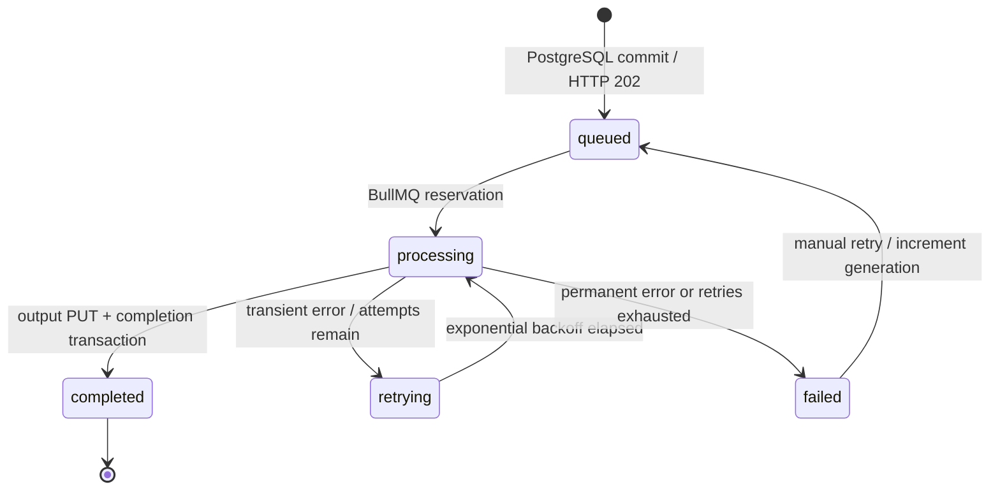

# Architecture and academic explanation

The supplied reference is [ACC lab.pdf](<ACC lab.pdf>), four pages; its abstract and page-two modular diagram were reviewed. This design preserves all eight modules and the asynchronous queue-driven Kubernetes worker architecture. PostgreSQL/outbox persistence is an addition for reliable job state and audits. The preferred **Option A** uses a Node BullMQ consumer that starts Python in its own pod/container through a documented subprocess protocol. Python does not consume BullMQ's internal Redis keys.

The diagram's optional gateway authentication and ELK stack are not implemented. This local academic workspace uses structured container logs and Prometheus/Grafana; infrastructure CPU/memory telemetry requires cluster metrics tooling. Its Nginx gateway and optional Ingress route requests, and KEDA scales the combined worker pods from actual queue length. These boundaries are explicit rather than represented by invented dashboard metrics.

| Module | Implementation | Responsibility |
| --- | --- | --- |
| Client | React/Vite/TypeScript/Tailwind, Axios, TanStack Query | Multiple uploads, transformation selection, actual status polling, result comparison, history, settings |
| API Gateway | Nginx | Same-origin routing, request-size limit, static assets and streaming proxy |
| Web Application/API | Express, Zod, Multer, Sharp, Prisma | Validate image signatures/metadata, store originals, persist jobs/outbox, serve state and signed downloads |
| Message Queue | Redis 7 + BullMQ 5 | Reserve work, renew locks, delayed exponential retry and failed-job retention |
| Worker | Node bridge + Python 3.12/Pillow/boto3 | Bounded asynchronous processing outside HTTP, safe decoding, transformation, upload and durable completion |
| Storage | MinIO + PostgreSQL | Private image bytes and authoritative metadata/audit trail |
| Monitoring & Logging | Prometheus/Grafana, JSON logs | Real DB/queue metrics, dependency health and job correlation |
| Result | API-issued S3 signature | Before/after previews and expiring private downloads |

```mermaid
sequenceDiagram
  participant C as Client
  participant A as API
  participant S as MinIO
  participant D as PostgreSQL
  participant Q as BullMQ / Redis
  participant N as Node bridge
  participant P as Python child
  C->>A: multipart images
  A->>A: signature + MIME + extension + pixel validation
  A->>S: private original PUT
  A->>D: Upload records
  A-->>C: 201 with upload UUIDs
  C->>A: POST jobs + transformations
  A->>D: transaction: Job + queued audit (outbox)
  A-->>C: 202 Accepted
  A->>Q: reconciler adds deterministic job ID
  Q->>N: reserved job / renewable lock
  N->>D: processing + attempts + audit
  N->>P: JSON request over stdin
  P->>S: download original
  P->>P: verify, decode, transform, encode
  P->>S: output PUT
  P-->>N: JSON result metadata
  N->>D: completion + output metadata + audit transaction
  N->>Q: processor returns; acknowledge success
  C->>A: GET status (polling or SSE)
  A-->>C: completed metadata + preview URLs
  C->>A: GET download
  A-->>C: 300-second signed URL
```

## Bridge protocol

Each BullMQ processor spawns exactly one `worker/runner.py`, with `shell:false`. A single JSON document of at most 32 KB is written to stdin:

```json
{"originalKey":"UUID/original.png","outputKey":"JOB_UUID/g0.webp","transformations":{"format":"webp","quality":82,"width":640}}
```

The server constructs object keys; clients cannot supply paths or external URLs. Credentials are inherited environment variables and never part of the document or process command arguments. Python prints a single JSON result to stdout:

```json
{"ok":true,"metadata":{"width":640,"height":400,"size":12000,"format":"webp","mime":"image/webp"}}
```

Failure: `{"ok":false,"permanent":true,"error":"Image is corrupt, unsupported, or exceeds safe limits"}`. A retryable failure uses `permanent:false`. Unexpected process exit, output overflow or timeout is retryable. stdout is capped at 16 KB; stderr is bounded and not exposed. No temporary image files are created. The bridge kills the child at `PROCESS_TIMEOUT_MS`, and the worker process renews BullMQ's job lock independently of Pillow's CPU work.

Python downloads and uploads objects; the Node side of the combined worker owns Prisma writes. This avoids duplicating database schemas and credentials protocols across languages. The separately buildable `worker/Dockerfile` is a CLI processor image for isolated verification. The deployed `worker` service uses `queue-bridge/Dockerfile` and includes Python, so it is the actual processing capacity.

## Lifecycle and failure semantics



- **Source of truth:** PostgreSQL owns visible job state. A Job with queued status is itself the transactional outbox; no dual-write transaction across Redis/PostgreSQL is claimed.
- **Publishing:** reconciler runs at startup and every five seconds. Job queue IDs are `JOB_UUID-gGENERATION`. If the API crashes after queue add but before recording dispatch, the same queue ID deduplicates republishing.
- **At-least-once delivery:** BullMQ renews locks and detects stalled consumers. An abrupt crash can cause another delivery. Output keys are deterministic per generation and guarded completion updates preserve completed state. There is no exactly-once processing claim.
- **Redis data loss:** nonterminal database jobs without Redis entries are republished. Normal Redis AOF and PostgreSQL/MinIO volumes preserve state across ordinary restarts. Redis AOF still has its own durability window.
- **Output succeeds, database fails:** delivery fails and retries can repeat the same transformation and overwrite the same private output key. A late failure cannot overwrite a committed completed job. Orphan outputs expire through bucket lifecycle.
- **Transient failures:** storage timeouts, processor crashes and unavailable dependencies. Up to `JOB_ATTEMPTS`, with 2s, 4s, 8s… exponential delay (default three total attempts).
- **Permanent failures:** corrupt/unsupported/animated images, invalid settings, decompression limits, missing objects and denied storage access. Node throws BullMQ `UnrecoverableError`, avoiding futile retries.
- **Dead letter:** failed BullMQ jobs remain in its failed sorted set (`bull:images:failed`) and have PostgreSQL failed records/audits. This is the documented dead-letter handling; no incompatible second queue is introduced. Reconciler repairs terminal state after stalled exhaustion. Manual retry increments generation; old failed deliveries cannot mutate the new generation.
- **Cancellation:** the endpoint returns 409, and the UI offers no unsafe cancellation. Removing active reservations without coordinating the processor could publish results after cancellation.
- **Progress:** 0% queued/retrying, 10% reserved/processing and 100% completed are real lifecycle milestones, not simulated per-pixel progress.
- **Retention:** original/output buckets expire image bytes after seven days by default; DB history is retained. Orphan uploads and outputs expire as well. Lifecycle expiration is asynchronous; credentials remain private.

## Safe image operation order

Verify compressed image → decode with pixel cap → EXIF orientation → clockwise rotation → resize → optional maximum 320×320 thumbnail → grayscale preserving alpha → optional text watermark → encode/strip source metadata → private output PUT. Aspect preservation fits within provided bounds; one provided dimension derives the other. An explicit two-dimensional stretch requires disabling preserve aspect. JPEG composites alpha on white. PNG's quality control chooses lossless compression effort; WebP/JPEG use lossy quality. Animated and multi-page inputs are rejected.

## Viva notes

**Docker** packages runtimes and dependencies into repeatable images; Compose is a multi-service local topology. **Kubernetes** schedules those containers in pods, uses Services for stable DNS and readiness to route traffic, restarts unhealthy containers and uses PVCs for durable data. The frontend's Nginx talks to `api:3000`; API and workers resolve `redis`, `postgres`, and `minio` in the namespace.

**A queue** decouples acceptance from expensive computation and absorbs bursts. API response latency does not include image transformation time. **Worker pods** isolate CPU/memory heavy processing from HTTP traffic. **KEDA** measures BullMQ's waiting list and adjusts replicas. It only observes a length; BullMQ performs all job state transitions. A minimum replica handles delayed retries and stall detection.

**MinIO/S3** stores bytes separately from relational records. Presigned URLs authorize temporary access without disclosing storage secrets. **Monitoring** quantifies throughput, failures, latency and backlog; structured logs explain an individual delivery using its job ID. **Fault tolerance** is bounded retry plus idempotency and durable state, not immunity to simultaneous loss of every persistence layer. Laptop manifests deliberately use single replicas for data services; production needs managed/HA storage and verified backups.

References: [BullMQ workers](https://docs.bullmq.io/guide/workers), [KEDA Redis list scaler](https://keda.sh/docs/2.18/scalers/redis-lists/), [MinIO pinned upstream release](https://github.com/minio/minio/releases/tag/RELEASE.2025-10-15T17-29-55Z).
