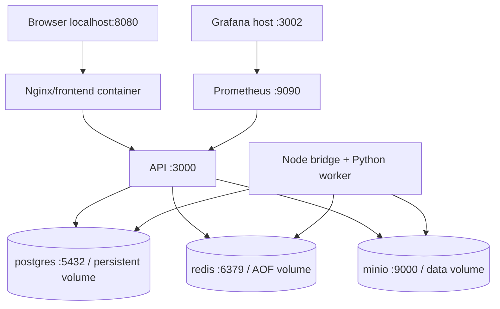

# Docker and local deployment

## Local Compose path

Install/start Docker Desktop with Linux containers. First verify `docker version` and `docker compose version`. From the repository root, copy `.env.example` to `.env` if absent. Then:

```sh
docker compose --profile monitoring up --build -d
docker compose ps
docker compose logs --tail 100 api worker
curl http://localhost:3000/api/v1/health/ready
```

Open http://localhost:8080. API starts only after migration, PostgreSQL connection and private bucket creation/lifecycle configuration. Worker starts after API readiness; frontend waits for API readiness in Compose. Local Docker health checks continue reporting status after startup. On Kubernetes, init containers/probes plus restarts replace Compose ordering.



Host ports bind to `127.0.0.1`. Container DNS uses service names, not localhost. The S3 client signing browser URLs uses `S3_PUBLIC_ENDPOINT`; internal S3 requests use `S3_ENDPOINT`. URLs are signed with the public endpoint before returning to the browser and must never be rewritten afterward.

MinIO's pinned source release builds with a Go stage and produces `cloudframe-minio:local`; this avoids relying on historical public-image availability. First-build network access to upstream Go modules is required. The upstream license/source remains upstream MinIO. [Upstream release instructions](https://github.com/minio/minio/releases/tag/RELEASE.2025-10-15T17-29-55Z).

If the local network blocks `sum.golang.org`, use a reachable mirror that serves the same signed checksum database, without disabling verification:

```sh
docker compose build --build-arg "GO_SUMDB=sum.golang.org https://goproxy.io/sumdb/sum.golang.org" minio
```

The Go client still verifies the original checksum database signatures. Source builds cache module/build downloads and bound compile parallelism to four. API/frontend/bridge builds share a locked npm download cache. The API uses Prisma 7's generated ESM client and official PostgreSQL driver adapter; database connection configuration lives in root `prisma.config.ts`.

## Resource model

Default worker concurrency is one. Compose memory limits: PostgreSQL 384 MB, Redis 256 MB, MinIO 512 MB, API 512 MB, worker 1 GB and frontend 96 MB. Monitoring adds two 256 MB limits. Docker itself/builds need additional headroom. Pixel limits and worker concurrency affect peak memory directly. Start with defaults; increase concurrency only with matching CPU/RAM and load-test evidence.

`.env` configures upload/pixel bounds, retries, processing timeout, retention and concurrency. API and workers must share the same bucket names, pixel/upload limits and database/Redis endpoints. The producer's `JOB_ATTEMPTS` controls automatic retry count at publication. The bridge enforces actual reservation concurrency and Python process timeouts.

## Build and health commands

```sh
docker compose build frontend api worker minio
docker compose exec api node -e "fetch('http://localhost:3000/api/v1/health/ready').then(async r=>console.log(r.status,await r.text()))"
docker compose exec worker node -e "fetch('http://localhost:3001/health/ready').then(async r=>console.log(r.status,await r.text()))"
docker compose exec redis redis-cli LLEN bull:images:wait
docker compose logs -f worker
docker compose up -d --scale worker=3
```

Dockerfile contexts are the repository root, including `worker/Dockerfile` (standalone CLI). The actual worker service uses the combined `queue-bridge/Dockerfile`. API and bridge images include the pinned npm toolchain/Prisma CLI so migration commands remain available; image size can be reduced with a separate production migration image later. Runtime API/processing use non-root users. Nginx's master runs with its upstream image defaults.

Health semantics: liveness means process responsive; readiness probes PostgreSQL/Redis/storage where relevant. Worker health listens on port 3001, not host-published. A worker stuck in a child is bounded by timeout while the Node event loop remains live.

## Data, secrets and production boundary

Volumes preserve relational state, queue AOF, objects and monitoring data. Stop with `docker compose down`; restarting uses the same data. PostgreSQL history remains after object retention. Back up PostgreSQL and MinIO consistently; Redis is recoverable for nonterminal jobs from the database outbox, but backups/HA still matter. Local manifests do not implement automatic multi-node failover.

Never check `.env` or real Kubernetes Secrets into version control. The `.env.example` and `secret.example.yaml` values are explicitly development-only. For a shared installation use a secret manager/external-secrets and workload identity or limited S3 service credentials, TLS termination, verified CORS origins and an authenticated API. Root MinIO credentials in this local stack simplify bucket initialization and must be replaced with separate setup/API/worker roles for production. Redis and PostgreSQL should only be reachable inside a protected network.

The API is intentionally one shared academic workspace. Request UUIDs and object key randomness are correlation/obscurity, not authorization. Add job ownership checks and authenticated result access before handling images from independent users. Browser preferences store only format, quality, aspect ratio and theme.

## Monitoring

Enable `--profile monitoring`. Prometheus scrapes `/api/v1/metrics` every 15 seconds and Grafana provisions a ready dashboard. The Kubernetes equivalent is `kubectl apply -k infrastructure/monitoring` after applying app Secrets.

| Metric | Meaning |
| --- | --- |
| `processed_jobs_total` | Cumulative count of persistently completed jobs; DB-backed across restarts |
| `failed_jobs_total` | Gauge of jobs currently terminally failed; decreases after manual retry |
| `image_processing_duration_seconds` | DB-backed histogram of successful attempt wall time including object transfer/commit, excluding queue wait |
| `queue_depth` | Current waiting + delayed BullMQ work |
| `active_jobs` | Current BullMQ active reservations |

Histogram buckets: 0.1, 0.5, 1, 2.5, 5, 10, 30, 60, 300 seconds and +Inf. Metrics use no filename/job ID labels. Structured worker logs use job IDs, generation, attempt and elapsed time. HTTP errors log correlation ID, status and error kind, never request bodies, image bytes or credentials. Dashboard statistics report actual connected consumers; these are not invented Kubernetes CPU/replica values.
