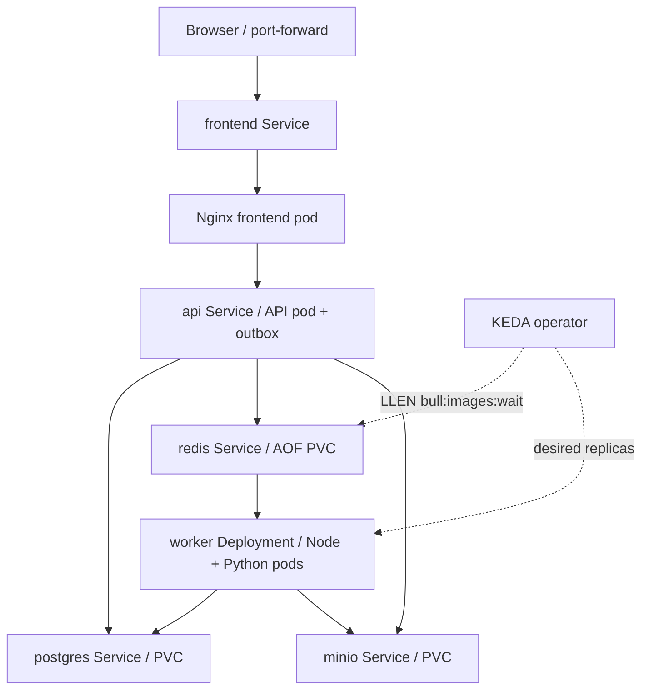

# Kubernetes and KEDA

The manifests target a resource-conscious local cluster. Dependencies have one replica and ReadWriteOnce PVCs with Recreate updates. They need a default StorageClass (provided by kind's normal local provisioner or minikube). No cloud load balancer is assumed. Kubernetes/Compose execution is separate from static file validation; see PROGRESS.md for actual checks run.

## Build and load into kind

Install Docker Desktop, kind, kubectl and Helm. From the repository root:

```sh
kind create cluster --config infrastructure/kubernetes/kind.yaml
docker build -t cloudframe-api:local -f backend/Dockerfile .
docker build -t cloudframe-worker:local -f queue-bridge/Dockerfile .
docker build -t cloudframe-frontend:local -f frontend/Dockerfile .
docker build -t cloudframe-minio:local -f infrastructure/docker/minio.Dockerfile .
docker pull postgres:16-alpine
docker pull redis:7.4-alpine
# Make .local first: PowerShell: New-Item -ItemType Directory .local -Force
# Linux/macOS: mkdir -p .local
docker image save --platform linux/amd64 -o .local/cloudframe-images.tar cloudframe-api:local cloudframe-worker:local cloudframe-frontend:local cloudframe-minio:local postgres:16-alpine redis:7.4-alpine
kind load image-archive .local/cloudframe-images.tar --name cloudframe
kubectl apply -f infrastructure/kubernetes/namespace.yaml
kubectl apply -f infrastructure/kubernetes/secret.example.yaml
kubectl apply -k infrastructure/kubernetes
kubectl -n cloudframe rollout status deployment/api --timeout=240s
kubectl -n cloudframe rollout status deployment/worker --timeout=240s
kubectl -n cloudframe get pods,pvc,svc
```

Applying the example Secret is for an isolated local demo only. For a shared cluster, copy it into ignored `.local/secret.yaml`, change every credential and apply that file instead. Keep DATABASE_URL and PostgreSQL password consistent. Consider deployment-specific image tags; after rebuilding/reloading local images, `kubectl -n cloudframe rollout restart deployment/api deployment/worker deployment/frontend deployment/minio` refreshes pods. Do not roll dependencies unnecessarily during active work.

The platform-specific archive avoids the `ctr: content digest ... not found` failure observed with Docker Desktop 29's containerd image store and kind's all-platform import. Match the export platform to the kind node (`linux/arm64` on an ARM node). Older Docker installations without `docker image save --platform` can use `kind load docker-image` instead. The full path was tested with kind 0.30.0 / Kubernetes 1.34.0.

The verified cluster in this workspace uses `.local/kubeconfig` rather than changing your default kubectl context. To inspect it in PowerShell:

```powershell
$env:KUBECONFIG=(Resolve-Path .local/kubeconfig).Path
kubectl -n cloudframe get pods,scaledobject,hpa
```

Project-local tool binaries, when installed during this session, are `.local/tools/kind.exe` and `.local/tools/helm/windows-amd64/helm.exe`; use those paths if kind/Helm are not on PATH.

If Compose is running, stop its services first (`docker compose --profile monitoring stop`) to free the local ports. Port-forward in separate terminals:

```sh
kubectl -n cloudframe port-forward service/frontend 8080:8080
kubectl -n cloudframe port-forward service/minio 9000:9000 9001:9001
kubectl -n cloudframe port-forward service/api 3000:3000
```

Open http://localhost:8080. Keep the MinIO port-forward active for previews and downloads: app-config's `S3_PUBLIC_ENDPOINT=http://localhost:9000` is intentionally browser-reachable, while internal storage uses `http://minio:9000`. For remote use, configure a real TLS storage endpoint and update Nginx CSP's img-src, API public endpoint and origins before rebuilding/deploying.

## Minikube alternative

```sh
minikube start --cpus=4 --memory=6144
minikube image build -t cloudframe-api:local -f backend/Dockerfile .
minikube image build -t cloudframe-worker:local -f queue-bridge/Dockerfile .
minikube image build -t cloudframe-frontend:local -f frontend/Dockerfile .
minikube image build -t cloudframe-minio:local -f infrastructure/docker/minio.Dockerfile .
```

Then apply the same namespace/Secret/Kustomize resources and use the same port-forwards. Optional ingress: `minikube addons enable ingress`, map `cloudframe.local` to your cluster's reachable IP, and `kubectl apply -f infrastructure/kubernetes/ingress.yaml`. Kind users can install a compatible ingress-nginx controller, or simply keep port-forwarding. S3 still needs its public endpoint/port-forward; this optional ingress only routes the frontend and API through Nginx.



## Install KEDA and autoscale

```sh
helm repo add kedacore https://kedacore.github.io/charts
helm repo update
helm upgrade --install keda kedacore/keda --namespace keda --create-namespace --version 2.18.1 --wait
kubectl apply -f infrastructure/kubernetes/keda.yaml
kubectl -n cloudframe get scaledobject,hpa
```

The **redis list** scaler observes `bull:images:wait` (BullMQ 5's default prefix `bull`, queue `images`). No priorities or queue pause are used, so waiting processing jobs use that list. It targets the **worker Deployment** whose image contains the Node consumer and actual Python processor. `listLength: "3"` aims for three waiting jobs per replica, min 1/max 4, 5-second polling, conservative scale-down. Verify the contract at runtime:

```sh
kubectl -n cloudframe exec deployment/redis -- redis-cli TYPE bull:images:wait
kubectl -n cloudframe exec deployment/redis -- redis-cli LLEN bull:images:wait
kubectl -n cloudframe get deployment worker -w
kubectl -n cloudframe describe scaledobject image-workers
```

When empty, Redis TYPE may be `none` because an empty list key does not exist; LLEN 0 is valid. Scaler reads list length only and does not mutate BullMQ internals. Active jobs and delayed retries are stored elsewhere. **Do not set min replicas to zero**: this local design relies on at least one BullMQ consumer to promote due retries and detect stalled work. The wait list may drain before a brief load triggers scaling; submit enough CPU-heavy work and observe at least 2–3 polling intervals. Scaling is load/resource dependent and not guaranteed for every small batch.

Local Redis has no password and is reachable only within the cluster. For ACL/TLS Redis, update Redis server, producer/worker URL and KEDA `TriggerAuthentication`/TLS metadata together. The stock config is not intended for an untrusted shared cluster. [Official scaler parameters](https://keda.sh/docs/2.18/scalers/redis-lists/).

## Load and fault-recovery demonstration

For the existing local cluster, demonstrate scaling without taking over Compose's ports:

```powershell
# Terminal 1, in the project directory; keep this running:
$env:KUBECONFIG=(Resolve-Path .local/kubeconfig).Path
kubectl apply -f infrastructure/kubernetes/keda.yaml
kubectl -n cloudframe port-forward service/api 3100:3000
```

```powershell
# Terminal 2, in the project directory; submit real jobs to Kubernetes:
$env:API_URL='http://localhost:3100/api/v1'
$env:JOBS='60'
npm.cmd run load
```

```powershell
# Terminal 3, in the project directory; observe actual replica changes:
$env:KUBECONFIG=(Resolve-Path .local/kubeconfig).Path
kubectl -n cloudframe get deployment worker -w
# Optional snapshots in another terminal:
kubectl -n cloudframe get hpa,scaledobject
kubectl -n cloudframe exec deployment/redis -- redis-cli LLEN bull:images:wait
```

The CLI workload uploads to the cluster's API and reads actual persistent job states; it does not use browser preview links, so a separate S3 port-forward is unnecessary for this load-only demonstration. Watch replicas increase toward the configured maximum of four, then settle back to one after backlog and stabilization clear. A previous actual run processed 24 heavier jobs with backlog 23 and observed 1 → 4 → 1 workers; future scaling depends on workload duration and available resources. Close these demonstration terminals afterward to discard the temporary API_URL/JOBS overrides.

Generate fixtures, port-forward API, then run `npm run load` (30 jobs by default, up to 200). In PowerShell use `$env:JOBS='60'`; in Unix `JOBS=60 npm run load`. Watch pods, ScaledObject/HPA, queue length and actual completions. Set worker concurrency to one to make replica effects visible. KEDA scaling can be observed during a burst only if the queue remains non-empty long enough.

For crash recovery, while a load is running: `kubectl -n cloudframe delete pod -l app=worker --grace-period=0 --force`. This intentionally terminates demo processing pods and is a manual fault injection; use only isolated demo workloads. Kubernetes replaces them. BullMQ's 90-second lock plus 30-second stalled scan can delay recovery; wait up to about two minutes before concluding a job is lost. Graceful normal shutdown has a 90-second pod grace period and drains work.

Observe `kubectl -n cloudframe logs deployment/worker --tail=100`, API audits and final job state. Deleting a data PVC is not part of this demonstration. Actual failover/autoscaling must be recorded when run; manifests and documentation alone do not demonstrate success.

## Monitoring and troubleshooting

```sh
kubectl apply -k infrastructure/monitoring
kubectl -n cloudframe port-forward service/prometheus 9090:9090
kubectl -n cloudframe port-forward service/grafana 3002:3000
kubectl -n cloudframe get events --sort-by=.lastTimestamp
```

Pending PVC: inspect default StorageClass. ImagePullBackOff: build/load exact local tags. API init loops: check PostgreSQL credentials/migration logs. Bucket initialization error: verify MinIO readiness and secret consistency. KEDA missing kind: install its CRDs via Helm before applying keda.yaml. Worker OOM: lower pixel bound/concurrency or add memory; CPU-bound latency is expected with one CPU. API readiness failure: inspect dependencies, not just liveness. Nginx proxy errors: `api` Service must resolve in the same `cloudframe` namespace. The app uses no Kubernetes service-account permissions; KEDA operator manages scaling separately.
