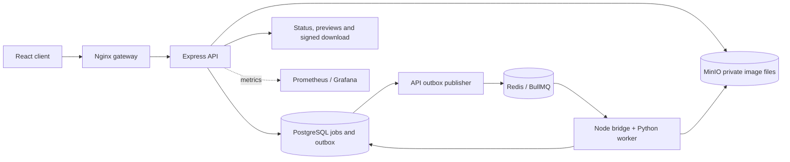

# Containerized Image Processing Service with Kubernetes Queue Workers

CloudFrame — Detailed Project Explanation

Prepared for Advanced Cloud Computing | Based on the implemented project | 26 October 2026

## 1. Introduction

CloudFrame is an application that lets a user upload images, choose editing operations, submit processing jobs, and download the results. Supported operations include resizing, compression, format conversion, rotation, grayscale, thumbnail creation, and a text watermark.

The main idea is to separate accepting a request from performing expensive image processing. The API receives and validates a request, saves a durable job record, and returns a job ID. Background workers perform the image operations separately. The website uses the job ID to display progress and retrieve the result.

This project demonstrates Advanced Cloud Computing through containers, asynchronous messaging, independently deployed services, Kubernetes orchestration, queue-driven worker scaling, persistent storage, monitoring, and recovery from failures.

The current deployment runs on a local computer. Docker Compose provides one environment, and kind provides a separate local Kubernetes environment. The use of cloud architecture and S3-compatible storage does not mean the application is currently hosted on AWS. Its architecture and deployment files demonstrate patterns that can be adapted to a cloud environment.

## 2. Problem Statement and Objectives

Image processing consumes CPU time and memory. A burst of image requests can arrive faster than a single processor can complete them. An application must track unfinished work, preserve original files, handle processing errors, and provide results without losing job information.

The project addresses these needs by recording jobs persistently and processing them through a queue. Processing capacity can be increased by running additional workers. The API, storage services, workers, and monitoring services have distinct responsibilities.

The project objectives are:

- Provide a usable interface for uploading and transforming images.
- Accept asynchronous processing requests and return job IDs.
- Preserve image files, job metadata, and audit events.
- Process images outside the API request lifecycle.
- Recover from temporary queue/storage failures and worker crashes.
- Demonstrate Kubernetes deployment and queue-based autoscaling.
- Expose real operational statistics and private result downloads.

## 3. What the Application Does

Users can submit JPEG, PNG, and WebP images. A batch can contain up to eight images, and each submitted image becomes a separate job. The settings selected for a batch apply to each image in that batch.

| Feature | Behavior in the implemented application |
| --- | --- |
| Multiple uploads | Select files or use drag-and-drop; the default limit is eight images per batch. |
| Resize | Set width, height, or both. Aspect preservation fits within the requested bounds; disabling it allows a two-dimensional stretch. |
| Compression/quality | JPEG and WebP use an encoding quality setting. For PNG, the setting controls lossless compression effort. |
| Format conversion | Produce JPEG, PNG, or WebP output. |
| Rotation | Rotate 90, 180, or 270 degrees clockwise. |
| Grayscale | Convert color to grayscale while preserving transparency where supported. |
| Thumbnail | Fit the image within a maximum 320 × 320 bounding box. |
| Watermark | Add optional text of up to 80 characters. |
| Progress tracking | Display actual lifecycle milestones: queued/retrying, processing, and completed. |
| Result comparison | Show original and processed images, dimensions, sizes, savings, and processing duration. |
| Job history | Search, filter, sort, inspect audit records, retry failed jobs, and download completed results. |
| Demonstration fixture | Generate a clearly identified sample image and process it through the real pipeline. |

The image operation order is: verify/decode, correct EXIF orientation, rotate, resize, apply thumbnail bounds, grayscale, watermark, and encode. JPEG output places transparent areas on a white background. Animation and multi-page images are rejected. An output may be larger than its input, especially after upscaling or changing format; negative size savings are valid.

### 3.1 The Six Dashboard Pages

| Page | What the user can do or observe |
| --- | --- |
| Dashboard | View real job totals, completion/failure counts, pending work, recent jobs, daily activity, and worker/queue statistics. |
| Process Images | Upload files, choose transformations, submit jobs, follow progress, compare previews, and download results. |
| Job History | Search filenames or full job IDs, filter by status, change sort order, paginate, and inspect job details. |
| Monitoring | Check actual dependency health, waiting/active/delayed work, connected consumers, limits, and monitoring links. |
| Architecture | Explore the eight modules and understand the processing lifecycle. |
| Settings | Save safe browser-local defaults such as output format, quality, and aspect preservation. |

## 4. The Eight Architectural Modules

The supplied reference, `docs/ACC lab.pdf`, describes eight modules. The implementation preserves this asynchronous architecture and adds PostgreSQL-backed persistence and recovery logic.

| Module | Technologies | Responsibility |
| --- | --- | --- |
| 1. Client | React, TypeScript, browser | Collect files/settings and display job progress and results. |
| 2. API Gateway | Nginx; optional Kubernetes Ingress | Serve the frontend and route API traffic to the application service. |
| 3. Web Application/API | Node.js, Express, Zod, Multer, Prisma | Validate requests, store originals, persist jobs, expose APIs, and publish queued work through the outbox. |
| 4. Message Queue | Redis and BullMQ | Hold deliveries, reserve work, maintain locks, schedule retries, and retain failed deliveries. |
| 5. Worker | Node BullMQ bridge, Python, Pillow, boto3 | Retrieve an original, transform it, upload its output, and commit the job outcome. |
| 6. Storage | MinIO and PostgreSQL | Store private image bytes separately from relational metadata and audit records. |
| 7. Monitoring and Logging | Prometheus, Grafana, Pino | Measure queue/job activity, display metrics, and record structured operational logs. |
| 8. Result | API, presigned S3 URLs, React previews | Expose completed metadata and temporary authorized access to image files. |



## 5. Detailed Image Processing Workflow

1. The user chooses files in the browser. The client supports file selection and drag-and-drop.
2. The browser sends a multipart upload to `POST /api/v1/images/upload`.
3. The API checks the extension, declared MIME type, actual image signature/metadata, file size, frame count, and dimensions. Python performs full image verification and decoding later.
4. Validated originals are saved to a private MinIO bucket using UUID-based object keys. Upload metadata is recorded in PostgreSQL.
5. The user selects transformations and clicks Process images. Uploading files alone does not create processing jobs.
6. The client calls `POST /api/v1/jobs` with upload IDs and settings. The API commits job records and queued audit events, then returns HTTP 202 Accepted with job IDs.
7. The API's outbox reconciler runs at startup and approximately every five seconds. It publishes outstanding jobs to BullMQ using a deterministic job ID for each job generation.
8. A Node BullMQ consumer reserves a delivery, maintains its lock, records the processing state, and starts one bounded Python child process for that delivery.
9. Python downloads the original from MinIO, safely verifies/decodes it, applies Pillow operations, and uploads the encoded output to the processed bucket.
10. Python returns a small JSON result containing dimensions, format, MIME type, and size. The Node side of the worker commits completed metadata and an audit event in PostgreSQL before returning success to BullMQ.
11. The browser polls unfinished job details about every two seconds. History/statistics generally refresh every five seconds. The API also provides SSE, but the shipped UI uses polling.
12. For a completed job, the API supplies preview URLs and a short-lived download URL. The browser retrieves the private object using the signature in that URL.

The processing-duration field measures the successful processing attempt after reservation. It excludes time spent waiting in the queue and time spent in earlier failed attempts. It should not be described as the user's complete upload-to-download waiting time.

## 6. Technologies and Tools in Detail

### 6.1 Frontend Technologies

| Technology | What it is | What it does in this project |
| --- | --- | --- |
| React | A library for building interactive interfaces from components. | Renders uploads, settings, job cards, history, health information, previews, and other dashboard screens. |
| TypeScript | JavaScript with compile-time type checking. | Describes settings, uploads, jobs, and statistics and catches many development-time mistakes. Runtime validation remains necessary. |
| Vite | A frontend development server and production build tool. | Provides local development, proxies development API requests, and builds optimized frontend assets. |
| Tailwind CSS | A utility/style tooling system. | Supplies the styling integration and design tokens; project CSS defines layouts, colors, forms, responsiveness, and themes. |
| React Router | Client-side routing for React. | Maps URLs to the six dashboard pages without requiring a full page reload for every navigation. |
| Axios | An HTTP client. | Sends uploads and API requests, observes upload progress, and surfaces request failures. |
| TanStack Query | A server-state fetching and caching library. | Fetches job/statistics data, polls active jobs, caches responses, and refreshes data after actions. |
| Recharts | A React chart library. | Draws the actual processing activity series returned by the API. |
| Lucide | An icon library. | Provides consistent navigation, status, upload, download, and settings icons. |
| Browser localStorage | Browser-local key/value storage. | Persists theme and safe processing defaults. It does not store MinIO secret credentials. |

### 6.2 API and Backend Technologies

| Technology | What it is | What it does in this project |
| --- | --- | --- |
| Node.js | A JavaScript runtime outside the browser. | Runs the API and the BullMQ producer/consumer logic. |
| Express | An HTTP server framework. | Defines REST endpoints, middleware, health routes, SSE, and error handling. |
| Zod | A runtime schema validation library. | Validates settings, upload IDs, query parameters, and server configuration before use. |
| Multer | Middleware for multipart file uploads. | Parses uploaded files and enforces per-file/count limits. This implementation buffers upload bytes in memory. |
| Sharp | An image library used by the API. | Reads actual image metadata/signatures and enforces upload dimension/frame constraints. The transformation pipeline itself is implemented in Pillow. |
| Prisma ORM | A typed database access and migration toolkit. | Connects the application to PostgreSQL, reads/writes records, performs transactions, and manages the schema migration. |
| Prisma PostgreSQL adapter | The database driver adapter used by Prisma 7. | Provides the PostgreSQL connection/pool used by the generated Prisma client. |
| AWS SDK for JavaScript | A client library for S3 APIs. | Lets Node store/check objects and generate signed MinIO URLs using the configured S3-compatible endpoint. |
| ioredis | A Node Redis client. | Provides Redis connectivity to BullMQ and the application's queue/health operations. |
| Helmet | HTTP security-header middleware. | Adds security-related HTTP headers to API responses. |
| CORS middleware | Browser cross-origin policy middleware. | Publishes access-control headers for the configured browser-origin allowlist. |
| express-rate-limit | Request-rate limiting middleware. | Limits general API requests and upload request frequency. |
| dotenv | Environment-file loading. | Loads host-development configuration; containers receive their configured environment through Compose or Kubernetes. |
| Pino | A structured JSON logger. | Records operational events with request/job correlation information without logging image bytes or storage passwords. |

### 6.3 Queue and Worker Technologies

| Technology | What it is | What it does in this project |
| --- | --- | --- |
| Redis | An in-memory data service with persistence options. | Stores BullMQ's waiting/active/retry/failed delivery state. The local deployment uses AOF persistence and a data volume. |
| BullMQ | A job-queue library using Redis. | Provides publishing, reservation, lock renewal, retry scheduling, stalled-delivery recovery, and acknowledgments. |
| Node queue bridge | The project's BullMQ consumer/dispatcher. | Owns queue semantics, starts Python for each delivery, enforces a timeout, and writes persistent job outcomes. |
| Python 3.12 | The processing runtime in deployed worker images. | Runs image processing separately from the API's HTTP request handling. |
| Pillow | A Python image-processing library. | Verifies, decodes, resizes, rotates, converts, grayscales, watermarks, thumbnails, and encodes image bytes. |
| boto3 | The Python AWS/S3 client library. | Downloads originals and uploads processed output using MinIO's S3-compatible API. |

BullMQ has a specific Redis job protocol. Python must not consume a BullMQ queue by removing arbitrary Redis list entries. This project therefore uses BullMQ's Node Worker API and a simple JSON stdin/stdout protocol between Node and Python. Credentials are inherited through the environment, rather than passed as user-controlled shell commands.

The deployed worker image contains both Node and Python. Scaling that pod adds real processing capacity. The separate `worker/Dockerfile` is a standalone Python CLI image; the deployed combined service uses `queue-bridge/Dockerfile`.

The Python requirements also include redis-py. It is not used by the current runner or Pillow functions: Node owns Redis/BullMQ communication. Python does not directly consume the queue or write PostgreSQL records.

### 6.4 Storage Technologies

| Technology | Stored information | Reason for its role |
| --- | --- | --- |
| MinIO | Original and processed image bytes in private buckets. | Object storage handles files through S3 APIs and separates large binary data from relational records. |
| PostgreSQL | Upload metadata, job state, settings, progress, attempts, object references, timestamps, errors, output metadata, duration, and audit events. | Relational storage supports transactions, persistent history, filtering, and indexed queries. |
| Docker volumes / Kubernetes PVCs | Persistent service data on the local deployment. | Preserve data beyond an individual application container restart. They are not a substitute for backups. |

The three database models are Upload, Job, and AuditEvent. Upload describes the original file; Job describes its requested processing and outcome; AuditEvent records lifecycle events. A Job references its Upload rather than duplicating all original-file data.

Original and processed buckets are separate by default. Object keys are generated from UUIDs and job generations. The default object retention is seven days. Lifecycle expiry is asynchronous and removes image bytes; PostgreSQL history remains until an operator applies a separate metadata-retention policy.

A presigned URL grants temporary access to a specific private object. The browser receives the signed URL rather than the storage secret key. Download links are generated for completed jobs and expire after 300 seconds.

### 6.5 Deployment and Infrastructure Tools

| Tool | What it is | Project use |
| --- | --- | --- |
| Docker | Container image/runtime tooling. | Packages application runtimes and dependencies into independently runnable images. |
| Docker Compose | A local multi-container application manager. | Starts the frontend, API, Redis, PostgreSQL, MinIO, worker, and optional monitoring profile with networking, volumes, and health checks. |
| Nginx | A web server and reverse proxy. | Serves production frontend assets and forwards `/api/` traffic to the API. It also sets frontend headers and a request-body limit. |
| Kubernetes | A container orchestration platform. | Runs Deployments and Services, performs health checks, restarts workloads, manages resource settings, and connects persistent storage. |
| kind | A tool for running Kubernetes nodes in Docker containers. | Provides the project's local Kubernetes test/deployment cluster. |
| minikube | Another local Kubernetes tool. | Has a documented alternative deployment path; the recorded cluster verification used kind. |
| kubectl | The Kubernetes command-line client. | Applies resources, inspects pods/services/HPA, reads logs, and performs port-forwarding. |
| Kustomize | Kubernetes manifest composition tooling. | Organizes and renders the base application and monitoring configurations through `kubectl kustomize`/`apply -k`. |
| Helm | A Kubernetes package manager. | Installs the KEDA operator and related services from its chart. |
| KEDA | Kubernetes Event-driven Autoscaling. | Observes the actual BullMQ waiting list and supplies scaling information for the worker Deployment. |

Compose and Kubernetes are separate deployments with separate Redis, PostgreSQL, MinIO, and persistent data. Requests sent to the normal Compose frontend do not automatically create jobs in the Kubernetes queue. A Kubernetes browser demonstration uses its own port-forwarded services, and a load demonstration must target the cluster API.

### 6.6 Monitoring and Logging Tools

| Tool | What it does |
| --- | --- |
| Prometheus | Scrapes the API's actual metric endpoint periodically and stores numeric time series. |
| Grafana | Queries Prometheus and displays the provisioned processing dashboard. |
| Structured JSON logs | Record request/processing events with correlation IDs for diagnosis. Job IDs are kept out of metric labels to avoid high-cardinality series. |
| PostgreSQL audit events | Preserve a job's lifecycle history independently of container log rotation. |

The exposed metrics include completed-job count, current terminally failed-job count, waiting/delayed queue depth, active deliveries, and a successful-attempt duration histogram. In this implementation, `failed_jobs_total` is explicitly exposed as a gauge of current failed database state, despite its name. It can decrease after successful manual retry. It should not be interpreted as a cumulative count of every failure ever observed.

The application Monitoring page obtains its statistics from the API. Its worker number is the count of connected BullMQ consumers; it is not CPU utilization or an authoritative Kubernetes replica inventory.

### 6.7 API Documentation, Testing, and Configuration Tools

| Tool | What it verifies or provides |
| --- | --- |
| OpenAPI 3.0 | Describes endpoint paths, request bodies, response schemas, parameters, and asynchronous HTTP 202 acceptance. |
| Swagger UI | Provides interactive API documentation at `/api/v1/docs`. |
| Swagger Parser | Validates the OpenAPI document's schema/references and helps detect malformed nesting or unresolved references. The project script also checks served/source parity. |
| Vitest | Runs Node/TypeScript API, outbox, and contract tests. |
| Supertest | Sends HTTP requests to the Express application during API boundary tests. |
| pytest | Tests real Pillow operations and invalid/corrupt/bomb/animated image handling. |
| Playwright | Tests real desktop/mobile browser behavior and live upload-to-download workflows. |
| YAML validation utilities | Parse deployment/monitoring configurations and check selected resource/probe/scaler contracts. Syntax checks do not prove deployment success. |
| `.env.example` and environment variables | Document configuration without embedding real deployment passwords in application code. |

The npm lockfile pins resolved JavaScript dependencies. Python runtime dependencies are pinned in `worker/requirements.txt`. Detailed executed test results are recorded separately in `docs/PROGRESS.md`.

## 7. How Advanced Cloud Computing Is Applied

### 7.1 Service Separation

HTTP handling, image processing, messaging, storage, and observability run as separate services. Workers can be scaled or restarted independently of the frontend. The API does not perform Pillow processing inside the upload/job-creation HTTP handler.

### 7.2 Asynchronous Communication

The queue separates the speed of incoming requests from the speed of processing. HTTP 202 means work was accepted; it does not mean the output is already ready. A job ID gives the client a way to obtain status later.

### 7.3 Containerization and Orchestration

Containers make runtime dependencies repeatable. Kubernetes adds workload scheduling, Service DNS, health probes, restart behavior, resource requests/limits, and persistent storage integration. Liveness asks whether a process is responsive; readiness asks whether it can currently serve its intended requests.

### 7.4 Horizontal Scaling and Elasticity

Horizontal scaling adds worker instances. Elasticity adjusts the number of instances as demand changes. KEDA reads the length of `bull:images:wait` and targets roughly three waiting jobs per replica, with a minimum of one and maximum of four in the supplied configuration.

For illustration, six waiting jobs may lead toward two worker replicas and twelve toward four. Actual scaling takes time, considers HPA behavior and resource availability, and is not an instantaneous guarantee. The scaler polls every five seconds and uses conservative scale-down settings. Active work and delayed retries are outside that waiting-list metric.

The whole Node/Python worker pod scales. One minimum consumer is retained to promote delayed work and detect stalled deliveries. In a local kind cluster, extra pods share the same computer's resources; KEDA does not create additional physical computers or cloud VMs.

### 7.5 Durability and Fault Tolerance

The API first commits job data in PostgreSQL. Its reconciler can publish outstanding work after Redis returns. BullMQ handles locks, retries, and stalled work. Deterministic generation-specific IDs and guarded updates make duplicate deliveries safe. Delivery is at least once; the project does not claim exactly-once computation.

### 7.6 Observability

Metrics explain aggregate system behavior, such as backlog and processing duration. Logs help investigate a particular delivery. Audit records explain the persistent history of a job. Together they support diagnosis and evidence-based scaling demonstrations.

## 8. Understanding the Limits and Monitoring Values

| Setting or value | Meaning |
| --- | --- |
| Eight images per batch | A fixed frontend/API upload and job-creation validation limit. It is not a lifetime job limit. |
| `MAX_UPLOAD_MB` | Size allowed per file; default 10 MB. It does not change the eight-file count. |
| `MAX_IMAGE_PIXELS` | Decoded/output pixel protection; default 25 million. |
| Two active upload requests | A per-API-process safeguard for in-memory upload buffers; separate from worker concurrency. |
| `WORKER_CONCURRENCY` | Jobs a single BullMQ consumer can process simultaneously; default one. |
| Worker replicas | Number of processing instances. Compose defaults to one; KEDA manages the Kubernetes worker Deployment within its configured range. |
| Connected workers | Current BullMQ consumer connections reported by the API. |
| Waiting | Jobs still in the queue waiting list. |
| Active | Reserved jobs currently being processed. |
| Delayed | Jobs waiting for a scheduled retry/delay. |
| Queue depth | Waiting plus delayed jobs in the dashboard metric; active jobs are reported separately. |

Multer keeps uploaded bytes in memory. Eight images at the default 10 MB limit can contain approximately 80 MB of compressed data before other overhead. The limit helps keep local requests manageable. Increasing it requires coordinated UI, API validation, OpenAPI, proxy, and resource changes. Nginx currently limits a complete request body to `84m`; raising a per-file limit may also require raising that separate batch-body limit.

Approximate simultaneous processing capacity is worker replicas multiplied by per-worker concurrency. One replica with concurrency one can process one image at a time. Three replicas with concurrency one can process three. One replica with concurrency three is still reported as one connected worker.

An illustrative eight-job batch with one worker may start with one active job and seven waiting. As images finish, waiting decreases. After completion, active and waiting both become zero while the worker remains running for new work. Small batches can finish before the next five-second Monitoring refresh. Zero waiting is a normal healthy idle state.

## 9. Reliability, Retries, and Security

### 9.1 Job States

- Queued: accepted and awaiting publication/reservation.
- Processing: a worker has started an attempt.
- Retrying: a temporary failure occurred and another bounded attempt is scheduled.
- Completed: output has been stored and completion metadata committed.
- Failed: a permanent failure occurred or allowed retries were exhausted.

Progress is a lifecycle indicator: zero for queued/retrying, approximately ten when processing starts, and one hundred when complete. It is not an estimate of how many individual pixels have been edited.

### 9.2 Recovery Behavior

The default retry configuration allows three total attempts with exponential delays starting at two seconds. Corrupt/unsupported images and invalid processing conditions are permanent failures. Temporary storage/network failures and unexpected processor exits can be retried. Processing is bounded by a default 60-second timeout, and BullMQ maintains a renewable reservation lock.

Failed deliveries remain available for diagnosis, and the database preserves safe error messages and audits. Manual retry increments the job generation so a new delivery can be distinguished from the old failed one. Earlier failed queue deliveries can remain recorded even after a later generation succeeds. Cancellation is intentionally unsupported and returns HTTP 409.

### 9.3 Security Controls and Boundaries

The implementation validates requests and image metadata, bounds file sizes and decoded pixels, rejects animation, uses UUID keys and private buckets, supplies temporary signed URLs, limits request rates, applies HTTP headers/CORS policy, and keeps storage secrets out of browser configuration. Python receives data through a defined JSON protocol; image requests do not become arbitrary shell commands or external fetch URLs.

The local application is a single shared academic workspace. User accounts, job ownership authorization, and TLS are not implemented. Shared/public deployment requires authentication, authorization, TLS, production secrets, backups, and appropriate HA services. The local data-service manifests use single replicas. Optional ELK and ingress are not required for the tested port-forward access path.

## 10. Project Folder Guide

| Location | Contents |
| --- | --- |
| `frontend/` | React pages, frontend types/API client, styling, Vite configuration, and frontend Dockerfile. |
| `backend/src/` | Express routes, validation contracts, configuration, storage/queue clients, OpenAPI document, and outbox reconciliation. |
| `backend/prisma/` | Database models and SQL migration. |
| `queue-bridge/` | BullMQ consumer, Python dispatcher, lifecycle updates, health endpoint, and combined worker image. |
| `worker/` | Pure Pillow transformations, S3 processing runner, pinned Python requirements, and standalone Python Dockerfile. |
| `infrastructure/docker/` | Nginx configuration and pinned upstream MinIO source build. |
| `infrastructure/kubernetes/` | Namespace, configuration, example Secrets, application/dependency deployments, Services, PVCs, kind and KEDA configuration. |
| `infrastructure/monitoring/` | Prometheus scrapes/alerts, Grafana provisioning/dashboard, and Kubernetes monitoring overlay. |
| `tests/` | API/outbox/OpenAPI tests, Python tests, browser tests, and generated image fixtures. |
| `scripts/` | Fixture generation, load/smoke/recovery checks, OpenAPI/infra validation, and Kubernetes verification utilities. |
| `docs/` | Architecture, API, deployment, Kubernetes, testing, demonstration, progress, and this guide. |

## 11. Running and Demonstrating the Project

Start Docker Desktop and use PowerShell in the project directory:

```powershell
Set-Location 'C:\Users\ajayl\OneDrive\Desktop\cloud-image-processing'
if (-not (Test-Path .env)) { Copy-Item .env.example .env }
docker compose --profile monitoring up --build -d
```

| Service | Local address |
| --- | --- |
| Frontend | http://localhost:8080 |
| API documentation | http://localhost:3000/api/v1/docs |
| API readiness | http://localhost:3000/api/v1/health/ready |
| MinIO S3 endpoint | http://localhost:9000 |
| MinIO console | http://localhost:9001 |
| Prometheus | http://localhost:9090 |
| Grafana | http://localhost:3002 |

Credentials are configured in the local environment file; use the documented development values only in the intended local environment. The Grafana username is admin. Detailed installation and Kubernetes instructions are in README.md, DEPLOYMENT.md, and KUBERNETES.md.

A practical demonstration is: upload a generated sample, choose width and format, submit, show queued/completed status, compare results, download the private output, inspect history/audit events, and then show real monitoring metrics. For Kubernetes autoscaling, target the cluster API and submit enough work to keep its waiting list non-empty while observing the worker Deployment/HPA. Increasing Compose replicas manually and KEDA autoscaling are different demonstrations.

Previously recorded verification includes API/outbox/OpenAPI parser tests, real Pillow tests, desktop/mobile browser workflows on Compose and Kubernetes, Redis outage and worker-crash recovery, private downloads, and a 24-job Kubernetes scaling run that observed workers increase from one to four and return to one. Creating this explanatory document does not constitute a new test run; exact executed results and their scope are in PROGRESS.md.

## 12. Short Answers for an Academic Presentation

| Question | Explanation |
| --- | --- |
| What is the project's main purpose? | Accept image transformation requests and process them reliably using asynchronous containerized workers. |
| Why use a queue? | It records waiting work and separates request arrival from processing speed. |
| Why use a separate worker? | CPU/memory-heavy image processing runs independently of the HTTP API and can scale separately. |
| Why both Node and Python in the worker? | Node correctly implements BullMQ delivery semantics; Python/Pillow performs the image operations. |
| Why PostgreSQL and MinIO? | PostgreSQL manages structured state/transactions; MinIO manages large image objects. |
| What does Kubernetes add? | Scheduling, Services, health-based operation, restarts, resource management, and a target for worker replica scaling. |
| What does KEDA add? | Queue-derived scaling signals for the actual worker Deployment. |
| Why only eight images in a batch? | It is an application-level request/memory safeguard; further batches can create more jobs. |
| Why one worker and zero queued? | One processor is available and no work is waiting; this is expected after a small batch completes. |
| Is this currently a public cloud deployment? | It is a locally deployed demonstration of cloud architecture using Compose and kind. |

## 13. Related Project Documents

- README.md: overview, prerequisites, startup commands, service URLs, and troubleshooting.
- docs/ARCHITECTURE.md: protocol, lifecycle, recovery semantics, and academic architecture explanation.
- docs/API.md: REST contracts, transformations, errors, polling/SSE, and parser validation.
- docs/DEPLOYMENT.md: Docker deployment, resources, persistence, monitoring, and secret management.
- docs/KUBERNETES.md: kind/minikube, image loading, Services, port-forwarding, KEDA, and autoscaling demonstrations.
- docs/TESTING.md: test commands and the distinction between mocked boundaries, syntax checks, and live processing.
- docs/DEMO.md: five-minute academic demonstration script.
- docs/PROGRESS.md: actual verification results, completed work, fixes, and remaining limitations.
